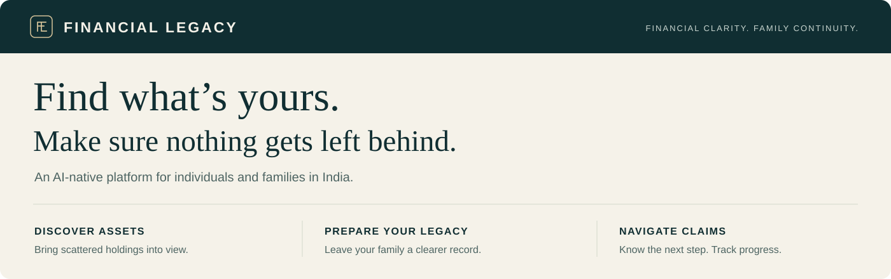

# Financial Legacy

**Help people in India find financial assets, prepare records for their families, and work through claims after a death.**

Financial records are spread across banks, investment companies, employers and insurers. People forget old holdings, and families may not know where to look or which documents to submit. Financial Legacy keeps the conversation, evidence and next steps in one case.

## Three ways to use it

| Need | Result |
| --- | --- |
| Find my assets | Reviewed holdings, separate possible matches and remaining gaps |
| Prepare for my family | A dated financial record and checklist of missing information |
| Handle a relative’s assets | Institution-specific claims with documents, follow-ups and outcomes |

Use any path independently. If the asset is already known, skip discovery and start the claim.

## What we build first

A web app using **made-up records only**, covering bank accounts, fixed deposits and mutual funds across all three paths. Users sign in, upload sample documents, review the proposed information, and use accepted records in an inventory, legacy record or claim.

The first assistant follows fixed rules, and document reading uses sample results. Claims use simulated manual receipts and outcomes. There is no running application or live financial connection yet.

Later scope includes other asset groups, voice, family sharing and permitted financial connections. Each needs its own permissions, policies and tests before use.

## How it works

**Explain the goal → establish permission → collect and review evidence → organize records or prepare a claim → track what happens.**

A statement value has a source and date; it is not a live balance. A possible match does not establish ownership or inheritance. Users review the exact content, recipient and purpose before an approved handoff or export. Adding a family contact sends nothing and grants no access. Institutions decide their own claim outcomes; complete discovery and successful recovery are not guaranteed.

## Only two documents to open

| You need to… | Read |
| --- | --- |
| Understand exactly what the product must do | [PRD.md](PRD.md) |
| Implement and test it | [BUILD_SPEC.md](BUILD_SPEC.md) |

This README is the product overview. Engineers can expand the reference sections in the build guide when needed. The [API](contracts/openapi.json), [database](contracts/schema.sql) and [sample data](contracts/fixtures.json) files are exact technical contracts, not additional team reading.

**Next: B-01 in the build guide.** Build sign-in → sample statement upload → field review → saved inventory first. Then complete legacy preparation, claims and the remaining first-release checks.

The PRD controls scope. Use synthetic records and generated local secrets; never commit real financial or identity documents or credentials.
